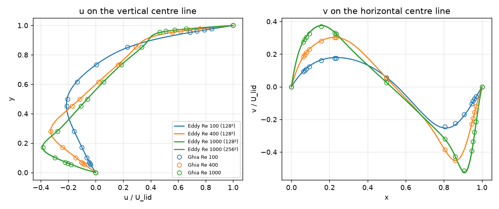
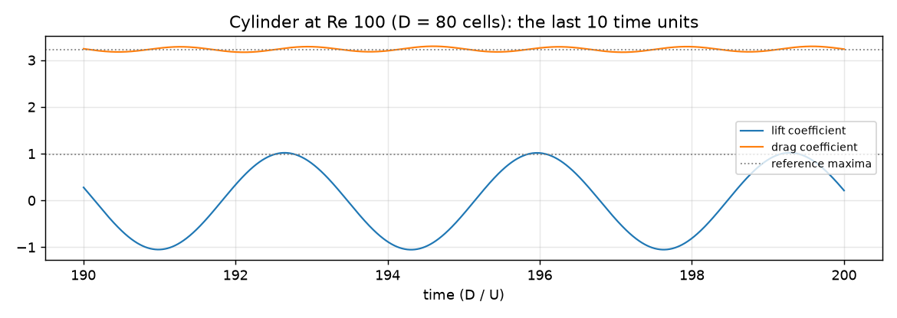
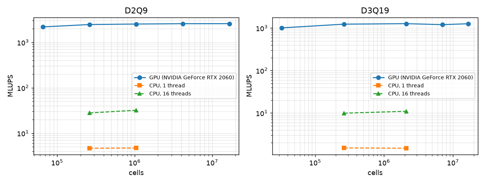

# Eddy

A lattice Boltzmann fluid solver for the GPU: D2Q9 and D3Q19 in C++/CUDA, with walls, moving
walls, velocity inlets, pressure outlets and obstacles read from images; validated in Python
against the classic benchmarks; and a live D2Q9 simulation in the browser in WebGL2.

```
src/            C++/CUDA solver: one cell-update function shared by the CPU and GPU back ends
tests/          C++ tests (equilibria, conservation, Poiseuille, force balance, CPU = GPU)
validation/     Python: runs the solver on the benchmark cases, compares with the references
viewer/         TypeScript/WebGL2: interactive flow past obstacles you draw
results/        validation.json, bench.json (the numbers quoted below)
docs/           figures
```

## The method

* **Lattices.** D2Q9 and D3Q19. Populations are stored structure-of-arrays in two buffers and
  streamed by *pull*: each cell gathers what its neighbours sent, collides, and writes once.
* **Collision.** TRT (two relaxation times) with the "magic" parameter Λ = 3/16, which puts
  bounce-back walls exactly halfway between nodes whatever the viscosity; BGK is available for
  comparison. Body forces follow Guo's scheme, its even and odd parts relaxed at their own rates.
* **Boundaries.** Halfway bounce-back for walls, with the momentum term for moving walls (the
  cavity lid). Inlets and outlets use Guo's non-equilibrium extrapolation (velocity or density
  prescribed, the non-equilibrium part copied from the neighbour). Obstacle forces come from
  momentum exchange.
* **Precision.** The solver is single precision, and it stores `f_i − w_i`, the departure from
  the fluid at rest, rather than `f_i`. This matters: `f_i` is about 0.1, while the part that
  carries the flow is 10⁻³ to 10⁻⁶ of that. Switching to shifted storage cut the cylinder
  benchmark's noise and turned the square-duct convergence from erratic into clean second order.
* **One code path.** `src/lbm.hpp` holds the per-cell update as `__host__ __device__` functions.
  The CUDA kernel and the OpenMP loop both call it, so their results are compared in the tests
  (they agree to 10⁻⁵) and their speeds are measured on the same algorithm.

## Build and run

```bash
cmake -S . -B build                       # -DEDDY_CUDA=OFF without the CUDA toolkit
cmake --build build --config Release
ctest --test-dir build -C Release
build/Release/eddy info                   # build/eddy on Linux
build/Release/eddy cylinder --d 40 --re 100 --out out/cyl
build/Release/eddy image --png shape.png --re 200 --steps 40000 --frames 20 --out out/img
```

Every case writes `fields.bin` (density and velocity) and `summary.json`; `cylinder` also
writes `forces.csv`. `--cpu` forces the CPU back end.

Validation (needs the solver built):

```bash
cd validation
python -m venv .venv && .venv/Scripts/pip install -r requirements.txt   # .venv/bin on Linux
python -m pytest -q tests
python -m eddy_validation.validate          # all cases, about 5 minutes on an RTX 2060
python -m eddy_validation.bench             # speed, GPU against CPU
```

The viewer:

```bash
cd viewer && npm install && npm run dev
```

## Results

All numbers come from `results/validation.json` and `results/bench.json`. They were measured
on an NVIDIA GeForce RTX 2060 (6 GB, 336 GB/s) and a 16-thread CPU, with CUDA 13.4 and MSVC on
Windows 11.

### Lid-driven cavity, against Ghia, Ghia & Shin (1982)



Centre-line velocities against Tables I and II of Ghia et al., as fractions of the lid speed.
The run stops when the velocity field changes by less than 5·10⁻⁵ (relative) per 1000 steps.
Lid speed is 0.1.

| Re   | grid | u: rms / max error | v: rms / max error | steps   | time   |
|------|------|--------------------|--------------------|---------|--------|
| 100  | 128² | 0.0029 / 0.0052    | 0.0046 / 0.0083    | 24,000  | 0.5 s  |
| 400  | 128² | 0.0021 / 0.0039    | 0.0019 / 0.0037    | 49,000  | 0.8 s  |
| 1000 | 128² | 0.0041 / 0.0072    | 0.0059 / 0.0105    | 79,000  | 1.1 s  |
| 1000 | 256² | 0.0035 / 0.0061    | 0.0083 / 0.0151    | 132,000 | 4.1 s  |

The profiles are within about 1% of the lid speed. The finer grid does not do better at
Re 1000. At that level the comparison is limited by Ghia's own data (a 129² multigrid solution,
tabulated to four digits, with one value known to be mistyped) rather than by this solver.

### Poiseuille flow, against the analytical parabola

A body-force-driven channel, `n` cells wide, with τ = 0.8. The table gives the relative L2 error
of the velocity profile.

| n  | TRT       | BGK       |
|----|-----------|-----------|
| 8  | 2.2·10⁻⁶  | 1.1·10⁻²  |
| 16 | 2.2·10⁻⁵  | 2.7·10⁻³  |
| 32 | 8.0·10⁻⁶  | 6.4·10⁻⁴  |
| 64 | 2.6·10⁻⁴  | 4.0·10⁻⁴  |

* **BGK** converges at second order (observed orders 2.02 and 2.11) until n = 64. Its error
  comes from the wall position, which with BGK depends on the viscosity.
* **TRT** with Λ = 3/16 reproduces the parabola exactly in exact arithmetic. What remains is
  single-precision rounding, and it grows with n: the force has to shrink as 1/n² to keep the
  speed fixed. At n = 64 the force added to a population each step is about 3·10⁻⁶, while the
  population is about 0.02, so float keeps only three or four digits of each increment. That
  same floor is what stops BGK's convergence at n = 64.

A double-precision build would remove the floor. Single precision was kept because it halves
the memory traffic, and memory traffic is what limits the speed.

### Square duct (D3Q19), against the series solution

| n  | L2 error  | order |
|----|-----------|-------|
| 8  | 4.0·10⁻³  |       |
| 16 | 8.8·10⁻⁴  | 2.20  |
| 32 | 2.1·10⁻⁴  | 2.04  |

### Flow past a cylinder: Schäfer & Turek (1996), 2D-1 and 2D-2

The setup is the DFG benchmark channel: 2.2 × 0.41, a cylinder of diameter 0.1 at (0.2, 0.2),
and a parabolic inflow. Reference values are from the FeatFlow benchmark pages (TU Dortmund).

* **Inflow.** The peak inflow is 0.05 lattice units (Mach 0.09). It is ramped up over 5 time
  units.
* **Re 20 (steady).** The drag and lift are averaged over the last 10% of 60 time units.
* **Re 100 (periodic).** The maxima and the Strouhal number are taken over the last half of 200
  time units, about 29 shedding periods.



**Re 20**, reference Cd = 5.5795, Cl = 0.010619:

| D (cells) | Cd    | error | Cl     | error | time  |
|-----------|-------|-------|--------|-------|-------|
| 20        | 5.737 | +2.8% | 0.0110 | +4.0% | 0.9 s |
| 40        | 5.650 | +1.3% | 0.0105 | −0.8% | 5.7 s |
| 80        | 5.639 | +1.1% | 0.0108 | +1.5% | 53 s  |

**Re 100**, reference Cd,max = 3.2200, Cl,max = 0.9859, St = 0.30188:

| D (cells) | Cd,max | error | Cl,max | error  | St     | error  | time  |
|-----------|--------|-------|--------|--------|--------|--------|-------|
| 20        | 3.517  | +9.2% | 1.171  | +18.8% | 0.2968 | −1.7%  | 3.6 s |
| 40        | 3.373  | +4.7% | 1.066  | +8.1%  | 0.3002 | −0.6%  | 23 s  |
| 80        | 3.337  | +3.6% | 1.030  | +4.5%  | 0.3012 | −0.2%  | 139 s |

* **Strouhal number.** It converges cleanly and is within 0.2% at D = 80.
* **Forces.** They converge too, but from above and slowly. Two known effects of plain
  bounce-back explain this:
  * a staircase cylinder is hydrodynamically a little larger than the true circle;
  * the error is first order in the cell size.

  An interpolated boundary (Bouzidi) would be the next step.
* **Mach number.** It matters. The first version used a peak inflow of 0.1 (Mach 0.17) and an
  impulsive start, and its Re 20 drag sat about 5.5% high at every resolution. Pressure waves
  bounced between the inlet and the outlet, and the mean had not settled after 60 time units.
  With a peak inflow of 0.05 and a ramped start, the error is 1.1%.

### Speed: million lattice updates per second



Fully periodic boxes were used. "Effective bandwidth" counts one read and one write of every
population per update (2 × Q × 4 bytes).

| lattice | cells    | GPU MLUPS | effective GB/s | CPU, 1 thread | CPU, 16 threads | GPU / CPU (16 threads) |
|---------|----------|-----------|----------------|---------------|-----------------|------------------------|
| D2Q9    | 1024²    | 2,525     | 184            | 4.7           | 32.0            | 79×                    |
| D2Q9    | 4096²    | 2,573     | 188            | —             | —               | —                      |
| D3Q19   | 128³     | 1,266     | 194            | 1.5           | 11.0            | 115×                   |
| D3Q19   | 256³     | 1,261     | 193            | —             | —               | —                      |

* **GPU.** The GPU reaches 56–58% of the RTX 2060's 336 GB/s. It is memory-bound, as lattice
  Boltzmann codes are. The cylinder runs reach 1,500–2,000 MLUPS, a little slower because of
  their inlet, outlet and obstacle branches.
* **CPU.** The CPU numbers are honest but not flattering. The CPU runs exactly the GPU's
  per-cell function: scalar code with a branch per direction and integer division for the
  coordinates. A CPU-specific implementation (vectorised across cells, without the per-link
  checks) would be several times faster. So the ratio above measures this code on the two
  devices, not the best achievable on each.
* **Browser.** The browser version runs the same scheme in fragment shaders and runs 640 × 240 live;
  the panel shows its own MLUPS figure (not measured here).

## The viewer

`viewer/` runs D2Q9 live in WebGL2:

* **Populations.** Stored in three RGBA32F textures, rendered to with multiple render targets and
  ping-ponged between two sets.
* **Scheme.** The same as the solver: pull streaming, halfway bounce-back, TRT.
* **Display.** Speed or vorticity, plus 16,384 tracer particles advanced on the GPU through the
  velocity field.
* **Obstacles.** Pick one (cylinder, airfoil, flat plate, two cylinders), draw with the mouse
  (the right button erases), or load an image where dark pixels are solid.
* **Controls.** The Reynolds number is a slider. When the requested Reynolds number would push
  the viscosity below a stable value, it is limited, and the panel says so.

It needs WebGL2 with `EXT_color_buffer_float`, which every current desktop browser has.

## Tests

* **C++ (ctest):**
  * equilibrium moments for both lattices;
  * mass conserved exactly at rest, and to within 10⁻⁴ with forcing and a moving lid;
  * Poiseuille accuracy with TRT, and that BGK is over 10× worse;
  * force balance on a block (the drag equals the body force on the fluid, within 1%);
  * open boundaries carrying the inflow profile;
  * CPU and GPU giving the same fields.
* **Python (pytest):** the convergence-order helper, the reference tables, the duct series, and
  small end-to-end runs (channel and cavity).
* **TypeScript (vitest):** the lattice, unit conversion, shapes, and image masks.

CI builds the CPU solver on Ubuntu and Windows and runs all of the above plus a quick
validation. It also compiles the CUDA code (there is no GPU to run it on) and builds the viewer.

## References

* U. Ghia, K. N. Ghia, C. T. Shin, "High-Re solutions for incompressible flow using the
  Navier-Stokes equations and a multigrid method", J. Comput. Phys. 48 (1982) 387–411. The
  tables were taken from a transcription and are in `validation/reference/`.
* M. Schäfer, S. Turek, "Benchmark computations of laminar flow around a cylinder" (1996), with
  reference values from the FeatFlow benchmark pages.
* I. Ginzburg, F. Verhaeghe, D. d'Humières, "Two-relaxation-time lattice Boltzmann scheme"
  (2008), for TRT and the magic parameter.
* Z. Guo, C. Zheng, B. Shi, "Discrete lattice effects on the forcing term in the lattice
  Boltzmann method" (2002), and "Non-equilibrium extrapolation method for velocity and pressure
  boundary conditions" (2002).
* A. J. C. Ladd, "Numerical simulations of particulate suspensions via a discretized Boltzmann
  equation" (1994), for momentum exchange.
* T. Krüger et al., *The Lattice Boltzmann Method: Principles and Practice* (Springer, 2017).

## License

MIT
